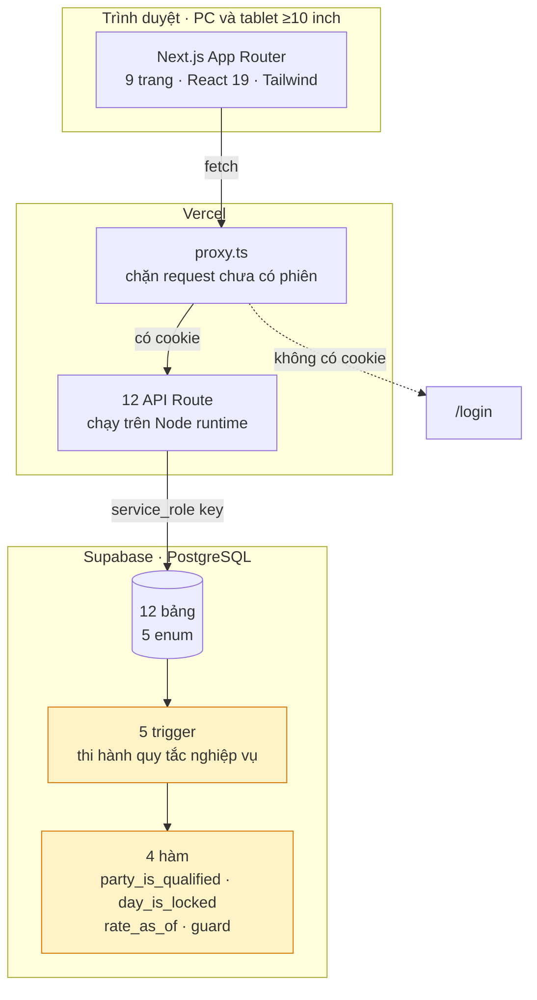
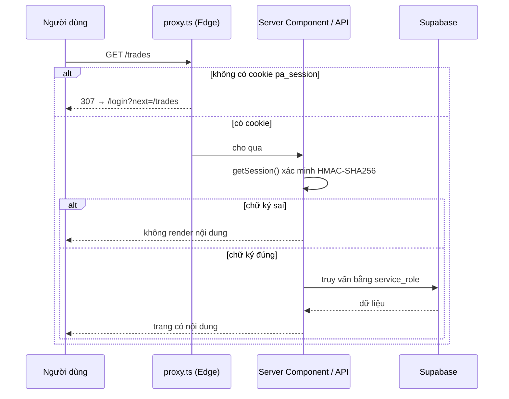
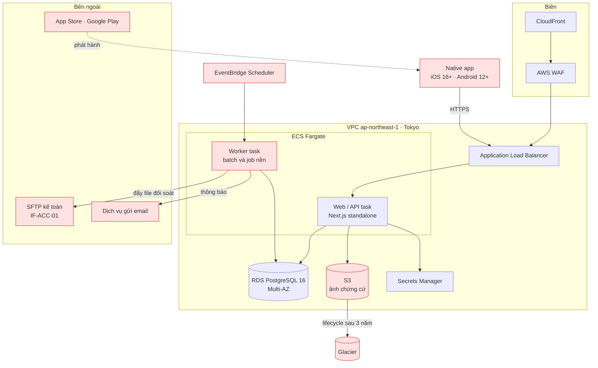
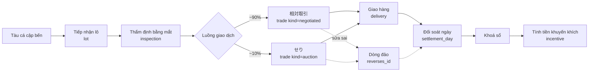
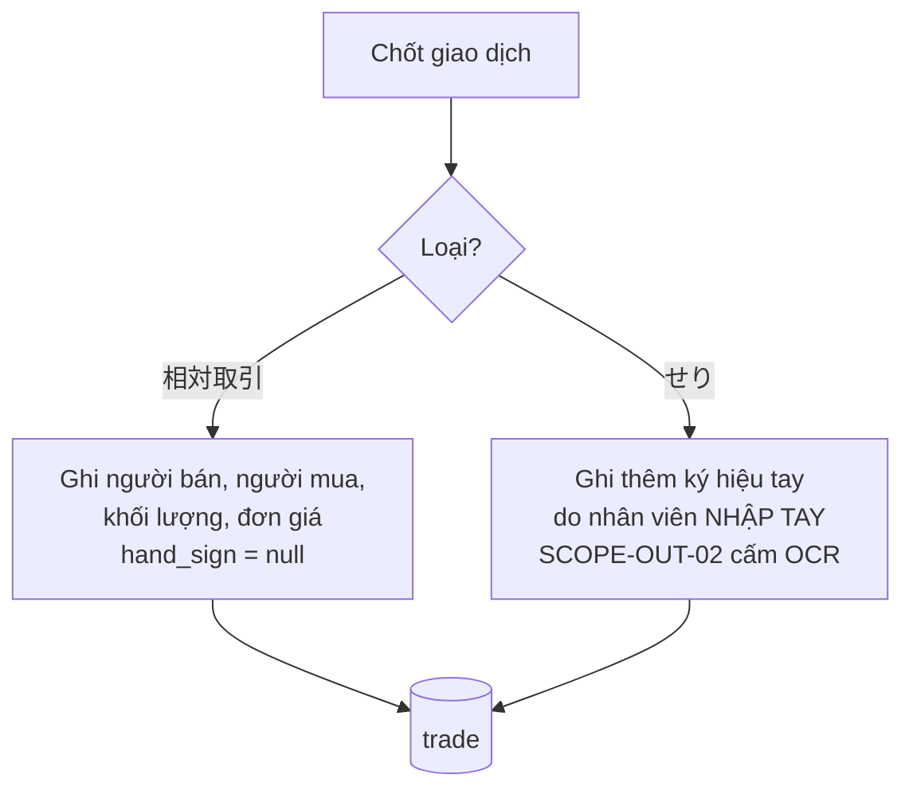
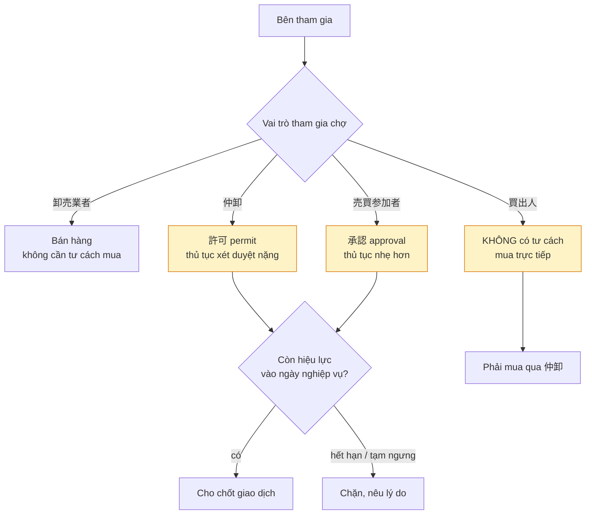
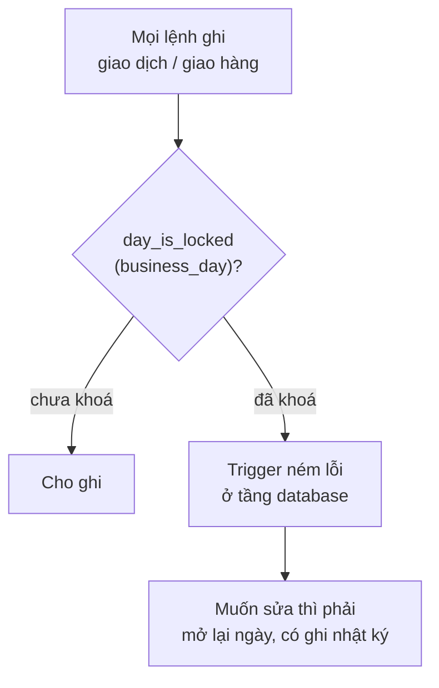
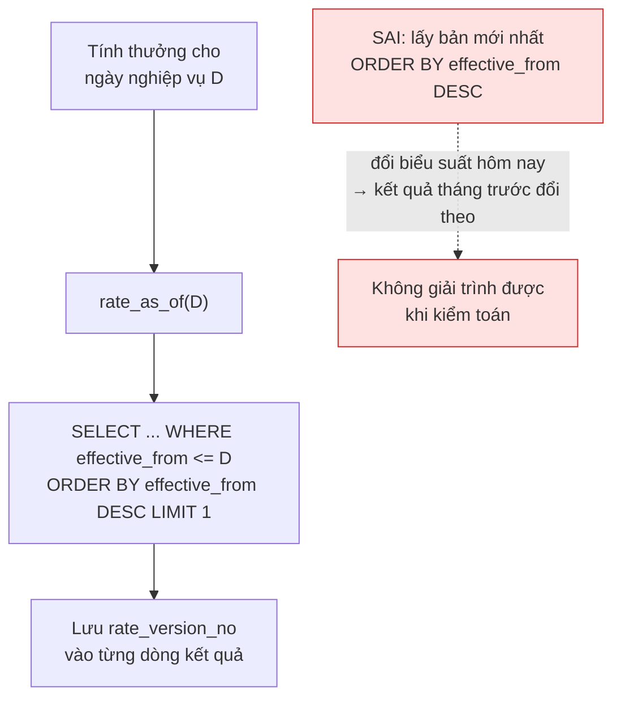

# Architecture design — Product A

Hệ thống hỗ trợ vận hành chợ bán buôn thủy sản 桜水産市場 (産地市場).

Tài liệu này mô tả **hai kiến trúc**, vì dự án thật sự có hai: bản PoC đang chạy ở LAB-3 và bản
production đã đề xuất ở LAB-1. Quyết định dùng hai đường được ghi ở [ADR-004](./03-adr.md#adr-004).

---

## 1. Bối cảnh nghiệp vụ quyết định kiến trúc

Bốn đặc thù dưới đây không phải chi tiết phụ — chúng là lý do hệ thống không thể dựng theo khuôn
CRUD thông thường. Mọi quyết định kiến trúc sau này đều quay về bốn điểm này.

| # | Đặc thù | Hệ quả lên kiến trúc |
|---|---|---|
| 1 | **相対取引 ~90% / せり ~10%** — thỏa thuận trực tiếp mới là luồng chính, không phải đấu giá | Một bảng giao dịch chung cho cả hai luồng, phân biệt bằng cột loại. Không dựng "auction engine" làm trung tâm |
| 2 | **Hai cấp pháp lý 許可 / 承認** — khác nhau về bản chất, cấm gộp | Bảng tư cách riêng, có ràng buộc buộc đúng cặp vai trò, kiểm tại thời điểm chốt giao dịch |
| 3 | **Sổ không được sửa** — dữ liệu đã chốt phải giải trình được khi kiểm toán | Mô hình ghi-thêm, sửa bằng bút toán đảo, khoá ngày nghiệp vụ |
| 4 | **Quy định đổi theo thời gian** — đổi biểu suất không được làm đổi kết quả kỳ trước | Tra quy định theo ngày nghiệp vụ, lưu lại phiên bản đã dùng |

Ngoài ra có **ràng buộc vận hành** hiếm gặp: khung giờ dịch vụ là **02:00–10:00 JST**, tức toàn
bộ tải nằm trong 8 giờ rạng sáng. Chợ nghỉ Chủ nhật. Điều này quyết định cách bố trí batch, cửa
sổ bảo trì và chế độ trực.

---

## 2. Kiến trúc PoC — đang chạy ở LAB-3

**Điểm cần chú ý:** khối màu vàng — quy tắc nghiệp vụ nằm ở tầng database, không ở tầng ứng dụng.
Gọi thẳng API bằng curl hay thao tác trực tiếp trên database đều không lách được. Lý do ở
[ADR-002](./03-adr.md#adr-002).

### Bảo vệ cổng vào — hai lớp

Lớp Edge chỉ kiểm tra **có** cookie hay không, vì Edge runtime không dùng được module crypto của
Node. Việc xác minh chữ ký thật nằm ở tầng server và được gọi lại ở từng trang, từng API route.
Cookie giả qua được lớp một nhưng chết ở lớp hai.

---

## 3. Kiến trúc production đề xuất

Khối màu đỏ là phần **chưa có trong PoC**. Danh sách đầy đủ kèm phân loại ở
[06-design-vs-code.md](./06-design-vs-code.md).

---

## 4. Luồng dữ liệu chính

Một ngày ở chợ đi theo mạch này. Mỗi mũi tên là một lần ghi vào sổ, không phải một lần sửa.

Tổng tiền ở bước đối soát **cộng cả dòng đảo mang số âm**, nên số ròng tự đúng mà không phải xoá
bản ghi nào. Đó là điểm lợi trực tiếp của mô hình ghi-thêm.

---

## 5. Bốn điểm phân nhánh đặc thù — không được làm phẳng

Đây là phần mục tiêu học tập LAB-4 nhấn mạnh: *"không đơn giản hóa thành luồng tuyến tính chung"*.

### 5.1 Nhánh loại giao dịch

Hai nhánh **vào cùng một bảng**. Nếu tách hai bảng thì mọi báo cáo, mọi phép đối soát và mọi quy
tắc khoá sổ đều phải viết hai lần, và tỷ trọng 90/10 không tính được bằng một truy vấn.

### 5.2 Nhánh hai cấp pháp lý

許可 và 承認 **không phải hai mức của cùng một thứ**. Gộp chúng thành một cờ `được_phép_giao_dịch`
là sai luật, và tài liệu khách cấm đích danh. Ràng buộc này được thi hành bằng trigger
`qualification_kind_check` — thêm ở LAB-4 sau khi phát hiện PoC thiếu (xem
[06-design-vs-code.md](./06-design-vs-code.md), mục L-01).

### 5.3 Nhánh khoá ngày nghiệp vụ

Kiểm ở trigger chứ không ở tầng ứng dụng. Nếu kiểm bằng câu `if` trong API thì gọi thẳng database
vẫn ghi được, và lời hứa "dữ liệu đã chốt không đổi" trở thành lời nói suông.

### 5.4 Nhánh tra quy định theo thời gian

Điều kiện `effective_from <= D` là toàn bộ sự khác nhau giữa đúng và sai ở đây. Bỏ nó đi thì mã
vẫn chạy, vẫn ra số, không báo lỗi gì — chỉ sai nghiệp vụ.

---

## 6. Điểm tích hợp

| Mã | Đối tác | Chiều | Phương thức | Trạng thái PoC |
|---|---|---|---|---|
| IF-ACC-01 | Hệ thống kế toán của khách | Ra | File CSV đẩy lên SFTP sau khi khoá sổ | **Chưa có** |
| — | Dịch vụ gửi email | Ra | SMTP, có thử lại | **Chưa có** |
| — | App Store / Google Play | Ra | Phát hành ứng dụng native | **Chưa có** (đã bỏ native) |
| — | Lưu trữ ảnh chứng cứ | Hai chiều | S3 + lifecycle sang Glacier sau 3 năm | **Chưa có** |

Phương thức của IF-ACC-01 vẫn là **giả định ASM-14 của LAB-1**, khách chưa xác nhận. Nếu khách
yêu cầu gọi API thay vì đẩy file thì phát sinh thêm tài liệu API, xử lý lỗi và thử lại.

---

## 7. Ràng buộc phi chức năng ảnh hưởng kiến trúc

| Mã | Yêu cầu | Kiến trúc đáp ứng thế nào | PoC |
|---|---|---|---|
| NFR-AVL-01 | 99,5% trong 02:00–10:00 JST | Multi-AZ, ALB, ECS nhiều task | Vercel SLA mặc định |
| NFR-AVL-02 | Tiếp nhận lô và ghi giao hàng chạy offline | Hàng đợi trên thiết bị native, đồng bộ khi có mạng | **Chưa có** |
| NFR-AVL-03 | RTO 4h, RPO 15 phút | RDS tự sao lưu + PITR | Supabase sao lưu mặc định |
| NFR-SEC-01 | MFA bắt buộc cho quản trị | Auth.js + TOTP | **Chưa có** — nợ kỹ thuật |
| NFR-PRIV-01 | Dữ liệu đặt tại vùng Nhật | VPC ap-northeast-1 | Cần chọn vùng Tokyo khi tạo Supabase |
| NFR-RET-01 | Dữ liệu 7 năm, ảnh 3 năm rồi lưu lạnh | S3 lifecycle → Glacier | **Chưa có** |
| NFR-BATCH-01 | Báo cáo ngày xong trước 11:00 JST | EventBridge kích hoạt worker sau khi khoá sổ | **Chưa có** |
| NFR-COMP-01 | 2 trình duyệt evergreen + tablet ≥10 inch | Responsive | ✅ đã có |
| NFR-COMP-02 | iOS 16+ / Android 12+ | React Native | **Đã bỏ** — xem ADR-008 |
