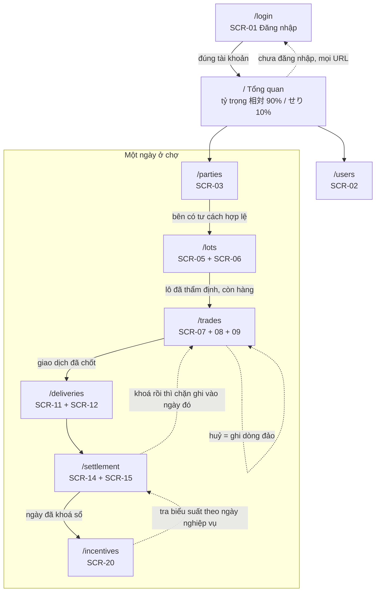
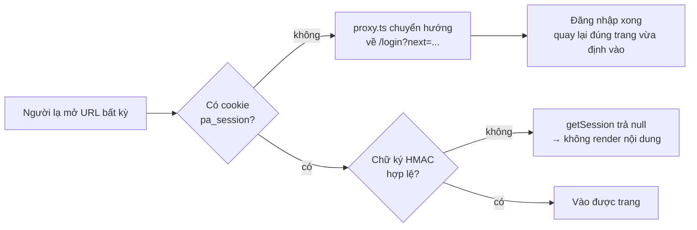

# Screen flow — luồng di chuyển giữa các màn hình

9 trang, phủ 12 mã màn hình của LAB-1. Thanh điều hướng trên cùng luôn hiện khi đã đăng nhập,
nên mọi trang đều tới được từ mọi trang. Sơ đồ dưới mô tả **luồng nghiệp vụ tự nhiên**, tức thứ
tự một ngày làm việc ở chợ thực sự diễn ra.

---

## Sơ đồ tổng



---

## Luồng chi tiết theo vai trò

### Tiếp nhận lô — `ROLE_INTAKE`

```
/login → / → /lots
            ├── Tiếp nhận lô mới (SCR-05): chọn đơn vị bán buôn, loài, khối lượng
            └── Lô vừa tạo xuất hiện ở bảng bên dưới, trạng thái chưa thẩm định
```

Nếu ngày hiện tại đã khoá sổ, nút tiếp nhận trả về lỗi từ API — không phải ẩn nút.

### Thẩm định — `ROLE_JUDGE`

```
/login → / → /lots
            └── Lô chưa thẩm định hiện 3 nút A / B / C (SCR-06)
                → chọn hạng → ghi vào inspection kèm tên người thẩm định
```

Không có nút "tự động chấm". Đây là ràng buộc nghiệp vụ: giữ con người trong vòng lặp.

### Chốt giao dịch — `ROLE_TRADE`

```
/login → / → /trades
            ├── Chọn loại: 相対取引 (thỏa thuận) hoặc せり (đấu giá)
            ├── Chọn lô còn hàng → chọn bên mua → nhập khối lượng, đơn giá
            │   └── Nếu chọn đấu giá: hiện thêm ô ký hiệu tay, nhân viên nhập tay
            └── Chốt → ghi vào trade, trừ khối lượng còn lại của lô

            Huỷ một giao dịch:
            └── Bấm Huỷ → nhập lý do → ghi DÒNG ĐẢO mới
                → dòng gốc bị gạch ngang nhưng VẪN NẰM TRONG SỔ
                → dòng đảo hiện nền đỏ, nhãn "đảo"
```

Ba trường hợp bị chặn, lỗi trả về nguyên văn từ trigger Supabase:
- ngày nghiệp vụ đã khoá sổ
- bên mua hết hiệu lực tư cách hoặc đang bị tạm ngưng
- lô không đủ khối lượng

Ô chọn bên mua chỉ liệt kê 仲卸 và 売買参加者. 買出人 không có tư cách giao dịch trực tiếp nên
không xuất hiện — đây là hệ quả của hai cấp pháp lý, không phải lọc cho gọn.

### Giao hàng — `ROLE_DELIVERY`

```
/login → / → /deliveries
            ├── Chọn giao dịch → nhập khối lượng giao → chọn kết quả
            │   └── Nếu chọn Ngoại lệ: bắt buộc nhập lý do
            └── Một giao dịch ghi được nhiều lần giao, hệ thống cộng dồn
```

### Đối soát và chốt sổ — `ROLE_SETTLEMENT`

```
/login → / → /settlement
            ├── Bảng đối soát từng ngày: thỏa thuận / đấu giá / dòng đảo / tổng ròng
            │   └── Tổng ròng cộng cả số âm nên tự đúng, không cần xoá dòng nào
            └── Khoá sổ (SCR-15) → xác nhận → từ đó chặn mọi ghi mới vào ngày đó
                                            → quay lại /trades thử chốt sẽ bị từ chối

      → /incentives
            ├── Chọn ngày nghiệp vụ → Tính thưởng
            └── Hệ thống tra biểu suất CÓ HIỆU LỰC VÀO NGÀY ĐÓ
                ├── 2026-09-29 → phiên bản 1 (1,5%)
                └── 2026-10-06 → phiên bản 2 (2,0%)
                → lưu số phiên bản đã dùng vào từng dòng kết quả
```

Vai trò khác bấm Khoá sổ sẽ nhận lỗi 403 từ API.

### Quản trị — `ROLE_SYS_ADMIN`

```
/login → / → /users
            └── Bật/tắt tài khoản (SCR-02) → ghi audit_log
                └── Không tự tắt được tài khoản của chính mình
```

---

## Bảo vệ cổng vào



Hai lớp: `src/proxy.ts` chặn ở cổng vào (chạy trên Edge nên chỉ kiểm tra có cookie hay không),
còn `getSession()` trong `src/lib/auth.ts` xác minh chữ ký thật ở tầng server và được gọi lại ở
từng trang, từng API route. Cookie giả qua được lớp một nhưng chết ở lớp hai.

---

## Bảng tra nhanh

| Trang | Mã màn hình LAB-1 | Nhóm | Vai trò chính |
|---|---|---|---|
| `/login` | SCR-01 | FEA-02 | tất cả |
| `/` | — (bổ sung) | — | tất cả |
| `/parties` | SCR-03 | FEA-01 | quản trị, đối soát |
| `/lots` | SCR-05, SCR-06 | FEA-03 | tiếp nhận, thẩm định |
| `/trades` | SCR-07, SCR-08, SCR-09 | FEA-04 | chốt giao dịch |
| `/deliveries` | SCR-11, SCR-12 | FEA-05 | giao hàng |
| `/settlement` | SCR-14, SCR-15 | FEA-06 | đối soát |
| `/incentives` | SCR-20 | FEA-07 | đối soát |
| `/users` | SCR-02 | FEA-02 | quản trị |

Trang Tổng quan `/` không có trong danh sách 30 màn hình của LAB-1 — bổ sung thêm để đặt tỷ
trọng 相対取引 / せり vào chỗ người xem nhìn thấy đầu tiên.
