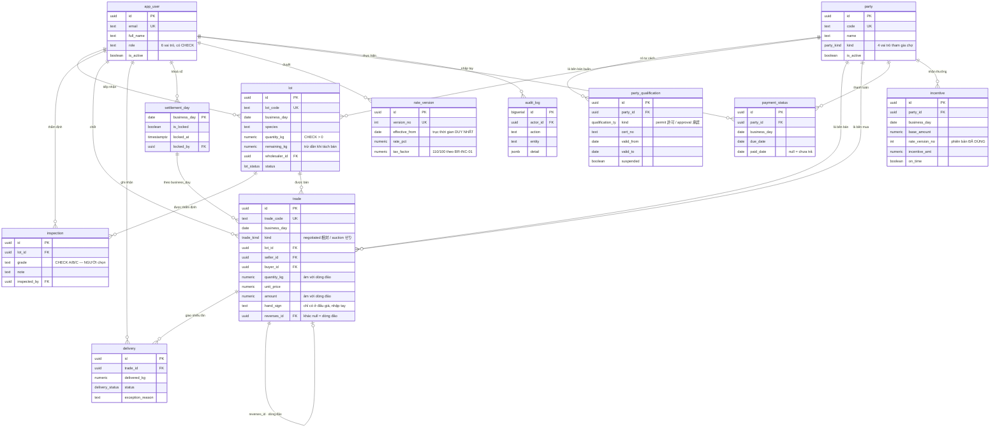

> Bổ sung cho `system-design/database-design/` — phần tổng quan, ERD và danh sách ràng buộc còn thiếu mà biểu mẫu BM-2-901-50 (đặc tả từng bảng) không chứa.

---

# Database design — Product A

Sơ đồ dưới dựng **từ `supabase/01_schema.sql` thật**, không phải từ thiết kế trên giấy. Mỗi bảng,
mỗi khoá ngoại, mỗi trigger đều đối chiếu được với mã nguồn.

12 bảng · 5 kiểu liệt kê · 4 hàm · 5 trigger.

---

## 1. Sơ đồ quan hệ

---

## 2. Quy tắc nghiệp vụ thi hành ở tầng database

Năm trigger và bốn hàm. Đây là phần quan trọng nhất của thiết kế dữ liệu — quy tắc đặt ở đây thì
không lách được bằng cách gọi thẳng API hay thao tác trực tiếp trên database.

| Đối tượng | Loại | Thi hành gì | Bảo vệ yêu cầu nào |
|---|---|---|---|
| `trade_no_update` | trigger BEFORE UPDATE | Ném lỗi, chặn mọi lệnh sửa bản ghi giao dịch | FR-CORR-02, dấu vết kiểm toán |
| `trade_no_delete` | trigger BEFORE DELETE | Ném lỗi, chặn mọi lệnh xoá | FR-CORR-02 |
| `trade_check` | trigger BEFORE INSERT | Chặn ghi vào ngày đã khoá; chặn bên mua hết tư cách | BR-CLOSE-01, BR-PERM-01 |
| `qualification_kind_check` | trigger BEFORE INSERT/UPDATE | Buộc 許可→仲卸 và 承認→売買参加者 | Mục 02-08 tài liệu khách |
| `delivery_quantity_check` | trigger BEFORE INSERT/UPDATE | Cộng dồn các lần giao, chặn vượt hợp đồng; chặn khi ngày đã khoá | FR-DEL-04, FR-DEL-05 |
| `party_is_qualified(party, day)` | hàm | Trả tư cách hợp lệ **vào ngày nghiệp vụ**, không phải hôm nay | BR-PERM-01 |
| `day_is_locked(day)` | hàm | Trạng thái khoá của một ngày | BR-CLOSE-01 |
| `rate_as_of(day)` | hàm | Biểu suất **có hiệu lực vào ngày đó**, không phải bản mới nhất | GOV-RULE-01 |
| `trade_append_only()` | hàm | Thông điệp lỗi chung cho hai trigger chặn sửa/xoá | — |

Hai trigger cuối cùng (`qualification_kind_check`, `delivery_quantity_check`) được **thêm ở
LAB-4** sau khi đối chiếu phát hiện PoC thiếu. Chi tiết ở [06-design-vs-code.md](./design-vs-code.md)` — cộng cả số âm nên ra số ròng đúng, không cần mệnh
đề loại trừ nào. Lịch sử đầy đủ, ai huỷ lúc nào vì sao đều còn.

Giá phải trả: mọi truy vấn đếm số giao dịch phải nhớ lọc `reverses_id IS NULL`, nếu không sẽ đếm
cả dòng đảo. Đây là chỗ dễ sai cho người mới — cần ghi rõ trong tài liệu cho đội dev.

---

## 4. Đối chiếu với mô hình dữ liệu LAB-1

| Thực thể LAB-1 | Bảng trong PoC | Khớp? | Ghi chú |
|---|---|---|---|
| Bên tham gia | `party` + `party_qualification` | ✅ | Tách làm hai, đúng hơn thiết kế gốc |
| Người dùng nội bộ | `app_user` | ✅ | |
| Lô hàng | `lot` | ✅ | |
| Kết quả thẩm định | `inspection` | ✅ | |
| Giao dịch | `trade` | ✅ | |
| Giao hàng | `delivery` | ⚠️ | Thiếu cột ảnh chứng cứ (SCR-13 chưa làm) |
| Ngày nghiệp vụ | `settlement_day` | ✅ | |
| Phiên bản quy định | `rate_version` | ⚠️ | **Chỉ một trục thời gian** — xem 4.1 |
| Trạng thái thanh toán | `payment_status` | ✅ | |
| Kết quả tính thưởng | `incentive` | ✅ | Có lưu `rate_version_no` để tái lập |
| Nhật ký kiểm toán | `audit_log` | ✅ | Ghi thật, chưa có màn hình tra cứu |
| Yêu cầu điều chỉnh | — | ❌ | SCR-16/17 chưa làm, bản chất đã có qua dòng đảo |
| Tranh chấp | — | ❌ | SCR-18 chưa làm |
| Thông báo | — | ❌ | FEA-11 chưa làm |
| Lịch chợ | — | ❌ | FEA-13 chưa làm |
| Hàng đợi offline | — | ❌ | Native đã bỏ |

### 4.1 Chỗ lệch nặng nhất — `rate_version` chỉ có một trục thời gian

Thiết kế LAB-1 nói **lưỡng thời gian (bitemporal)**: hai trục thời gian độc lập.

| Trục | Ý nghĩa | PoC có? |
|---|---|---|
| `effective_from` | Quy định này áp dụng cho nghiệp vụ **từ ngày nào** | ✅ có |
| `recorded_at` | Hệ thống **biết đến** quy định này từ lúc nào | ❌ không |

Thiếu trục thứ hai thì không trả lời được câu: *"Ngày 15/10, tại thời điểm đó, chúng ta tưởng
biểu suất của ngày 01/10 là bao nhiêu?"*

Câu hỏi này không phải học thuật. Nếu ban quản lý chợ ban hành một quy định **có hiệu lực hồi
tố** vào ngày 20/10 cho nghiệp vụ từ 01/10, thì bảng tính thưởng in ra ngày 15/10 và bảng in lại
ngày 25/10 sẽ khác nhau — và không có cách nào chứng minh bảng ngày 15/10 đã đúng tại thời điểm
in. Trong tranh chấp tiền bạc, đó là lỗ hổng thật.

**Chưa sửa ở LAB-4**, vì thêm trục thời gian thứ hai kéo theo đổi mô hình truy vấn của toàn bộ
phần tính thưởng. Xếp vào nợ kỹ thuật, ghi ở [06-design-vs-code.md](./design-vs-code.md)` | Kiểm tư cách tại thời điểm chốt |
| `lot` | `(business_day)` | Danh sách lô theo ngày |
| `trade` | `(business_day)`, `(kind)`, `(lot_id)` | Đối soát ngày, lọc theo luồng, trừ tồn lô |
| `delivery` | `(trade_id)` | Cộng dồn khối lượng đã giao |
| `inspection` | `(lot_id)` | Lấy kết quả thẩm định |
| `audit_log` | `(created_at DESC)` | Tra cứu gần nhất trước |

**Chưa có và sẽ cần** khi dữ liệu tích luỹ theo NFR-RET-01 (7 năm):

- `trade (buyer_id, business_day)` — tính thưởng theo bên tham gia
- `trade (reverses_id)` — tìm dòng đảo của một giao dịch
- Phân mảnh `trade` và `audit_log` theo năm — ở tải thiết kế 600 lô và 1.200 giao dịch mỗi ngày,
  sau 7 năm bảng `trade` sẽ vượt 3 triệu dòng
