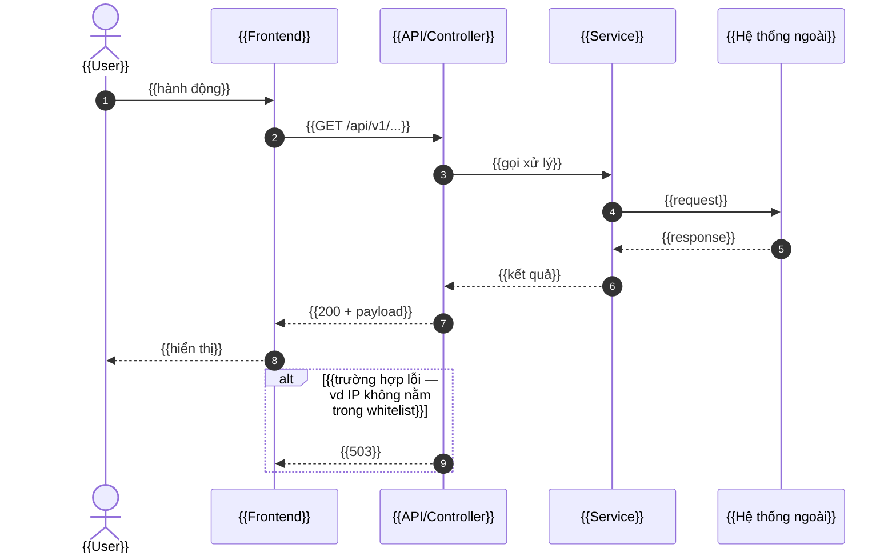

# BM-2-901-53 — Detail Design

    

Biểu mẫu Markdown Detail Design (BM-2-901-53). Trong repo dự án (copy từ framgia/management_template)
file nằm ở specs/_templates/BM-2-901-53-detail-design-template.md. Hướng dẫn cách dùng nằm trong khối comment ở đầu file.

Nội dung file — bấm nút copy ở góc khối code để lấy toàn bộ:

---
id: SPEC-XXX-000
title:
type: system
subtype: detail-design
design_id: XX_FUNCTION
function:
endpoint:
component:
feature:
version: "0.1.0"
updated_by:
updated: YYYY-MM-DD
related: []
---

<!--
  Template Detail Design (Chart + Description) — port từ biểu mẫu ISO BM-2-901-53 v01.
  Nguồn: 02-context-inputs/bm-2-901-53-detail-design/

  CÁCH DÙNG
  1. Copy file này thành `{feature}/{DESIGN_ID}_DETAIL.md`, điền frontmatter trước.
  2. Mục 1 History of change: xoá dòng mẫu, đánh lại từ `1 · 0.1.0 · Add new · Khởi tạo`.
  3. Điền từ trên xuống. Xoá các khối comment và chữ trong {{...}} khi xong.
  4. Mục 4 lặp lại khối `4.x` cho mỗi bước xử lý — thêm/bớt bước và thêm/bớt dòng tuỳ function.
  5. Ô không có dữ liệu thì để trống; mục không áp dụng ghi "N/A + lý do", không xoá tiêu đề.

  FRONTMATTER — không có mục "Thông tin tài liệu" trong thân file, mọi trường định danh nằm ở
  frontmatter để tra được bằng máy:
    design_id  mã tài liệu, viết HOA (vd `AUTH_LOGIN`)   function  tên function
    endpoint   `GET /api/v1/login` — không có thì để trống (batch, job nội bộ)
    component  service / module / class chạy xử lý này — tên phải KHỚP TỪNG KÝ TỰ với tên
               thành phần trên sequence diagram ở mục 2
    related    link sang spec màn hình / API Design liên quan

  MỘT FUNCTION = MỘT FILE. Biểu mẫu gốc để chart (sequence diagram) và description ở hai
  sheet riêng vì một sheet không chứa được cả hai; Markdown thì không có hạn chế đó — tách
  làm hai file là tự tạo hai nguồn cho cùng một luồng xử lý.

  QUY ƯỚC LOG không nằm trong file này (dùng chung cả dự án, không thuộc riêng một function)
  — xem `_common/log-convention.md`. Log mà function này ghi ra thì mô tả ở cột "Nội dung xử lý"
  của bước tương ứng.
-->

# {{DESIGN_ID}} — {{Tên function}}

> Biểu mẫu: **BM-2-901-53 v01** — Detail Design (Chart + Description) · SUN ASTERISK VIETNAM CO., LTD · ISO/IEC 27001:2013 & ISO 9001:2015

---

## 1. History of change

| No | Version | Action | Mục / Bước | Nội dung thay đổi | Ngày | Người sửa | Approve |
|---|---|---|---|---|---|---|---|
| 1 | 0.1.0 | Add new | — | Khởi tạo | YYYY-MM-DD | {{tên}} | |

<!-- `Action`: `Add new` · `Update` · `Delete`.
     `Approve`: để trống = khách hàng chưa duyệt version ở dòng đó. Đã duyệt thì ghi
     `✅ YYYY-MM-DD · [bằng chứng](link)` — ngày KH xác nhận, link comment trên Issue / email KH.
     Chỉ khách hàng phê duyệt; Tech Lead chỉ ghi nhận, nội bộ duyệt PR không điền ô này. Điền qua
     PR, đã điền thì không xoá; không gắn tag khi duyệt — tag chỉ gắn khi release source code.
     Từ khi có version đã được duyệt (ô `Approve`), mỗi lần sửa bắt buộc thêm một dòng và tăng version theo SemVer
     (MAJOR đổi luồng xử lý/hợp đồng dữ liệu · MINOR bổ sung bước hoặc lỗi mới · PATCH sửa chữ).
     Dòng cuối bảng này phải khớp `version` / `updated` ở frontmatter và khớp dòng trong
     `03-specs/_index.md` — ba nơi không được lệch. -->

---

## 2. Sequence diagram

**File nguồn của sơ đồ:** [{{tên file/frame}}]({{link Draw.io / Figma / Miro}})

> - Ảnh lưu trong `{feature}/assets/`, **tên có tiền tố Design ID** (`{{DESIGN_ID}}_sequence.png`), nhúng bằng đường dẫn tương đối.
> - Vẽ bằng Draw.io / Figma / PlantUML — **không** vẽ bằng Excel hay Spreadsheet. Luôn để lại link file nguồn để người sau sửa được, ảnh PNG không sửa lại được.
> - Sửa luồng xử lý ở mục 4 thì **phải xuất lại ảnh trong cùng lần sửa đó** — ảnh và mục 4 lệch nhau là lỗi nặng nhất của tài liệu này.
> - Tên thành phần trên sơ đồ phải **khớp từng ký tự** với `component` ở frontmatter.
> - Mọi nhánh lỗi vẽ trên sơ đồ phải có một dòng trong bảng `Error` của bước tương ứng ở mục 4, và ngược lại.

Bản Mermaid (tuỳ chọn — dùng khi muốn Git diff đọc được nội dung sơ đồ)

Ký hiệu: `->>` gọi đồng bộ · `-->>` trả về · `-)` gọi bất đồng bộ · `alt/else` nhánh điều kiện · `opt` nhánh tuỳ chọn · `loop` vòng lặp. `autonumber` đánh số bước để đối chiếu với mục 4.

**Dùng cả ảnh và Mermaid thì hai bản phải cùng nội dung** — chỉ giữ Mermaid khi cam kết cập nhật cả hai; không thì xoá khối này đi.

---

## 3. Description

*{{Mô tả function: giải quyết việc gì, ai gọi vào, chạy xong thì hệ thống ở trạng thái nào.}}*

---

## 4. Detail function

**Chia bước theo trách nhiệm, không theo dòng code.** 3–7 bước là khoảng hợp lý; quá 10 bước thì function đang làm quá nhiều việc — tách ra.

### 4.1. {{Validate request}}

| Trường | Giá trị |
|---|---|
| Input | {{kiểu dữ liệu + nguồn — vd `Request object` (query params: `source_carrier`, `target_carrier`)}} |
| Output | {{kiểu dữ liệu + truyền cho bước nào — vd `Request object` → bước 4.2}} |

**Error**

| Điều kiện lỗi | Xử lý | Status code |
|---|---|---|
| {{Inbound IP Address không nằm trong whitelist}} | {{ghi log + set vào response object, dừng xử lý}} | {{503}} |
| {{JWT trong cookie không hợp lệ hoặc hết hạn}} | {{ghi log + set vào response object, dừng xử lý}} | {{401}} |

**Detail**

| No | Nội dung xử lý |
|---|---|
| 1 | {{việc cần làm, một câu, có động từ — nêu luôn điều kiện bỏ qua nếu có}} |
| 2 | {{...}} |
| 3 | {{...}} |

### 4.2. {{Generate callbackUrl}}

| Trường | Giá trị |
|---|---|
| Input | {{...}} |
| Output | {{...}} |

**Error**

| Điều kiện lỗi | Xử lý | Status code |
|---|---|---|
| {{env setting thiếu cấu hình cho cặp carrier}} | {{...}} | {{500}} |

**Detail**

| No | Nội dung xử lý |
|---|---|
| 1 | {{...}} |
| 2 | {{...}} |

### 4.3. {{Building response}}

| Trường | Giá trị |
|---|---|
| Input | {{...}} |
| Output | {{...}} |

**Error**

`N/A — {{lý do bước này không sinh lỗi}}`

**Detail**

| No | Nội dung xử lý |
|---|---|
| 1 | {{...}} |

<!-- - Cột `Xử lý` phải trả lời được: nghiệp vụ DỪNG hay ĐI TIẾP.
     - Bước không sinh lỗi thì ghi `N/A + lý do`, đừng xoá tiêu đề `Error` — người review cần
       phân biệt "đã cân nhắc, không có lỗi" với "chưa ai nghĩ tới".
     - Mã lỗi trả ra ngoài cho client phải có sẵn trong `_common/error-codes.md` — không tự chế.
       (Biểu mẫu gốc để Error thành từng cặp dòng "điều kiện" / "status code" — bản mẫu trắng
       không nhìn ra được quy ước đó nên hay bị điền sai; ở đây gộp thành một dòng ba cột.) -->

---

## 5. Other Notes

*{{Tiền đề trước khi gọi, ranh giới "function này KHÔNG làm gì", tích hợp ngoài (timeout / retry / lỗi thì dừng hay đi tiếp), câu hỏi còn treo. Viết thành gạch đầu dòng; có nhiều mục thì trình bày dạng bảng.}}*