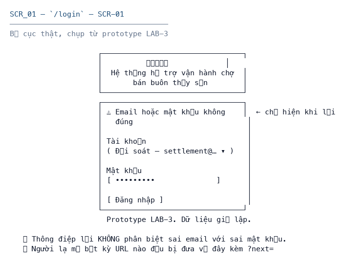

# SCR_01 — Đăng nhập

> Biểu mẫu: **BM-2-901-51 v2.1** — Screen Specification · SUN ASTERISK VIETNAM CO., LTD · ISO/IEC 27001:2013 & ISO 9001:2015

---

## 1. History of change

| No | Version | Action | Nội dung thay đổi | Ngày | Người sửa | Approve |
|---|---|---|---|---|---|---|
| 1 | 0.1.0 | Add New | Khởi tạo từ bộ thiết kế LAB-4 | 2026-10-11 | nguyen-van-manh-c | |

---

## 2. Layout

**Design:** bản dựng chạy thật tại `/login` của prototype LAB-3

> Ảnh chụp từ prototype đang chạy. Màn hình này **đã code**, nên bố cục dưới đây là bố cục thật,
> không phải phác thảo.

---

## 3. Description

Tạo cookie pa_session ký HMAC-SHA256, httpOnly, 8 tiếng. Ghi audit_log action=LOGIN.

**Nguồn đặc tả:** mã nguồn LAB-3.

**Vai trò truy cập:** Quản trị hệ thống `F` · Tiếp nhận lô `F` · Thẩm định `F` · Chốt giao dịch `F` · Giao hàng `F` · Đối soát `F`

---

## 4. View

### 4.1 Danh sách item

| ID | Item Name | Item Type | Required | Note |
|---|---|---|---|---|
| **A** | **Đăng nhập** | | | |
| 1.0 | email | Text box | Có | 6 tài khoản demo |
| 2.0 | password | Text box | Có | Kiểu password, không hiện ký tự |

### 4.2 Validation

| ID | Type | Min | Max | Default | Ghi chú |
|---|---|---|---|---|---|
| A-1 | String |  | | | bắt buộc; lỗi dùng `M_01` |
| A-2 | String |  | | | bắt buộc; lỗi dùng `M_01` |

### 4.3 Data Mapping

| ID | Data Source | API ID | API URL | Key / Param | Ghi chú |
|---|---|---|---|---|---|
| A-1 | API | `AUTH-1` | `POST /api/auth/login` | — | tra ở [`_common/api-list.md`](../../_common/api-list.md) |

---

## 5. Event

| ID | Given (Pre-condition) | When (Trigger/Action) | Then (Result) | Note |
|---|---|---|---|---|
| **Initializing Process** | | | | |
| - | đã đăng nhập, phiên hợp lệ | mở màn hình | 1. Gọi `POST /api/auth/login` 2. Hiển thị danh sách | |
| **Standard Process** | | | | |
| A-1 | - | thao tác trên item | Email phải tồn tại trong app_user và is_active = true | |
| A-2 | - | thao tác trên item | Mật khẩu so với DEMO_PASSWORD trong biến môi trường | |
| A-3 | - | thao tác trên item | Sai thì trả 401 kèm thông điệp chung, KHÔNG nói sai email hay sai mật khẩu | |
| **Error Handling** | | | | |
| - | chưa đăng nhập | gọi API | HTTP 401, chuyển về `/login?next=` | `M_40` |

---

## 6. Other Notes

- **Trạng thái:** Trống → đang nhập → đang kiểm tra → thành công chuyển tới ?next= · thất bại hiện lỗi
- Email phải tồn tại trong app_user và is_active = true
- Mật khẩu so với DEMO_PASSWORD trong biến môi trường
- Sai thì trả 401 kèm thông điệp chung, KHÔNG nói sai email hay sai mật khẩu
