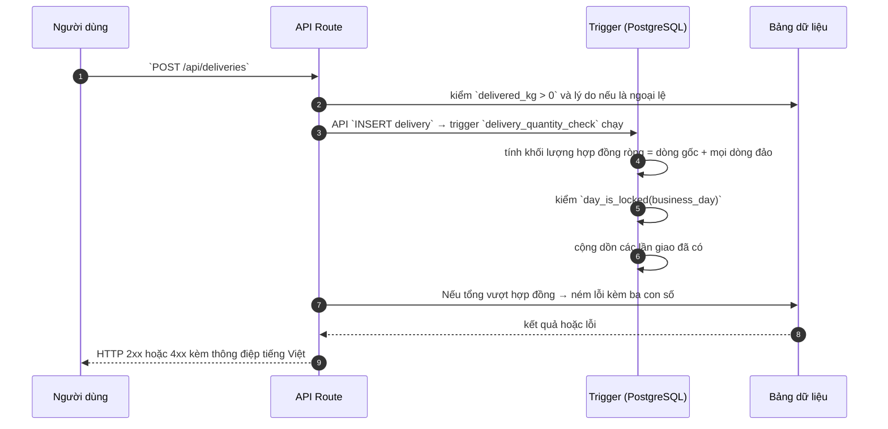

# DLV_CREATE — Ghi nhận lần giao hàng

> Biểu mẫu: **BM-2-901-53 v1.1** — Technical Design · SUN ASTERISK VIETNAM CO., LTD · ISO/IEC 27001:2013 & ISO 9001:2015

---

## 1. History of change

| No | Version | Action | Nội dung thay đổi | Ngày | Người sửa |
|---|---|---|---|---|---|
| 1 | 0.1.0 | Add New | Trích từ `src/app/api/deliveries/route.ts` của prototype LAB-3 | 2026-10-11 | nguyen-van-manh-c |

---

## 2. Sequence diagram

---

## 3. Description

Mã nguồn: `src/app/api/deliveries/route.ts`

Luồng xử lý chia làm các bước ở mục 4. Điểm chung của mọi hàm trong hệ thống này: **quy tắc nghiệp vụ
thi hành ở tầng database bằng trigger**, tầng API chỉ chuyển tiếp thông điệp lỗi cho người dùng đọc.
Xem [ADR-002](../../../_extra/decisions/ADR-002-quy-tac-o-tang-database.md).

---

## 4. Detail function

### 4.1. Validate

| Mục | Nội dung |
|---|---|
| Input / điều kiện | `delivered_kg > 0`; `exception_reason` bắt buộc khi `status = exception` |
| Error | 400 |

### 4.2. Kiểm hợp đồng ròng

| Mục | Nội dung |
|---|---|
| Input / điều kiện | Dòng gốc cộng dòng đảo; ≤ 0 nghĩa là đã huỷ hết |
| Error | 409 — giao dịch đã bị huỷ |

### 4.3. Kiểm ngày khoá

| Mục | Nội dung |
|---|---|
| Input / điều kiện | `day_is_locked(business_day)` |
| Error | 409 |

### 4.4. Cộng dồn

| Mục | Nội dung |
|---|---|
| Input / điều kiện | `SUM(delivered_kg) + lần này <= hợp đồng` |
| Error | 409 kèm đã giao / lần này / hợp đồng |

---

## 5. Other Notes

- Mọi thông điệp lỗi do trigger ném ra được trả **nguyên văn** cho người dùng, không thay bằng câu chung chung.
- Mã lỗi dùng chung tra ở [`_common/error-codes.md`](../../_common/error-codes.md).
