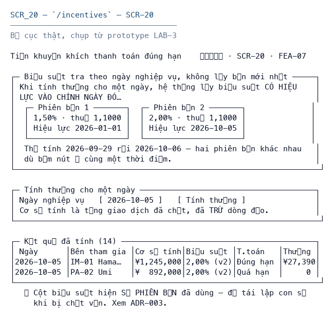

# SCR_20 — Kết quả tính thưởng

> Biểu mẫu: **BM-2-901-51 v2.1** — Screen Specification · SUN ASTERISK VIETNAM CO., LTD · ISO/IEC 27001:2013 & ISO 9001:2015

---

## 1. History of change

| No | Version | Action | Nội dung thay đổi | Ngày | Người sửa | Approve |
|---|---|---|---|---|---|---|
| 1 | 0.1.0 | Add New | Khởi tạo từ bộ thiết kế LAB-4 | 2026-10-11 | nguyen-van-manh-c | |

---

## 2. Layout

**Design:** bản dựng chạy thật tại `/incentives` của prototype LAB-3

> Ảnh chụp từ prototype đang chạy. Màn hình này **đã code**, nên bố cục dưới đây là bố cục thật,
> không phải phác thảo.

---

## 3. Description

Thứ tự phép tính và cơ sở áp thuế vẫn là giả định ASM-10. Xem ADR-003.

**Nguồn đặc tả:** mã nguồn LAB-3.

**Vai trò truy cập:** Quản trị hệ thống `R` · Tiếp nhận lô `–` · Thẩm định `–` · Chốt giao dịch `–` · Giao hàng `–` · Đối soát `F`

---

## 4. View

### 4.1 Danh sách item

| ID | Item Name | Item Type | Required | Note |
|---|---|---|---|---|
| **A** | **Kết quả tính thưởng** | | | |
| 1.0 | business_day | Text box | Có |  |
| 2.0 | base_amount | Label | - | Tổng giao dịch đã chốt, TRỪ dòng đảo |
| 3.0 | rate_version_no | Label | - | Phiên bản ĐÃ DÙNG, lưu để giải trình |
| 4.0 | rate_pct | Label | - | Từ rate_as_of(business_day) |
| 5.0 | on_time | Label | - | paid_date <= due_date |
| 6.0 | incentive_amt | Label | - | floor(base × rate% × tax_factor) |

### 4.2 Validation

| ID | Type | Min | Max | Default | Ghi chú |
|---|---|---|---|---|---|
| A-1 | Date |  | | | bắt buộc; lỗi dùng `M_01` |

### 4.3 Data Mapping

| ID | Data Source | API ID | API URL | Key / Param | Ghi chú |
|---|---|---|---|---|---|
| A-1 | API | `INC-1` | `GET /api/incentives` | — | tra ở [`_common/api-list.md`](../../_common/api-list.md) |
| A-2 | API | `INC-2` | `POST /api/incentives` | — | tra ở [`_common/api-list.md`](../../_common/api-list.md) |

---

## 5. Event

| ID | Given (Pre-condition) | When (Trigger/Action) | Then (Result) | Note |
|---|---|---|---|---|
| **Initializing Process** | | | | |
| - | đã đăng nhập, phiên hợp lệ | mở màn hình | 1. Gọi `GET /api/incentives` 2. Hiển thị danh sách | |
| **Standard Process** | | | | |
| A-1 | - | thao tác trên item | Biểu suất tra theo NGÀY NGHIỆP VỤ, không lấy bản mới nhất — GOV-RULE-01 | |
| A-2 | - | thao tác trên item | base_amount <= 0 thì bỏ qua, không tính thưởng | |
| A-3 | - | thao tác trên item | Trả sau hạn hoặc chưa trả → incentive_amt = 0 | |
| **Error Handling** | | | | |
| - | chưa đăng nhập | gọi API | HTTP 401, chuyển về `/login?next=` | `M_40` |

---

## 6. Other Notes

- **Trạng thái:** Chưa tính → đã tính (ghi đè được bằng upsert)
- Biểu suất tra theo NGÀY NGHIỆP VỤ, không lấy bản mới nhất — GOV-RULE-01
- base_amount <= 0 thì bỏ qua, không tính thưởng
- Trả sau hạn hoặc chưa trả → incentive_amt = 0
- Làm tròn XUỐNG đơn vị JPY — BR-INC-01
- Một bên một ngày một kết quả — UNIQUE (party_id, business_day)
