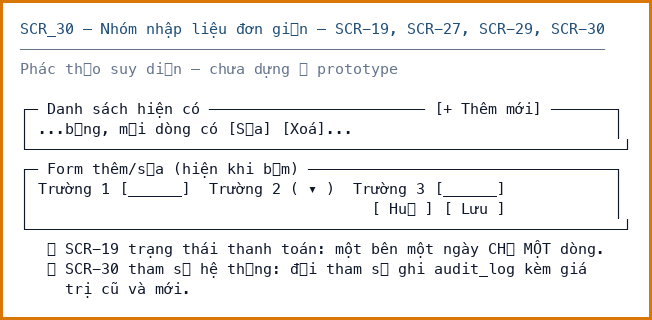

# SCR_30 — Danh mục và tham số hệ thống

> Biểu mẫu: **BM-2-901-51 v2.1** — Screen Specification · SUN ASTERISK VIETNAM CO., LTD · ISO/IEC 27001:2013 & ISO 9001:2015

---

## 1. History of change

| No | Version | Action | Nội dung thay đổi | Ngày | Người sửa | Approve |
|---|---|---|---|---|---|---|
| 1 | 0.1.0 | Add New | Khởi tạo từ bộ thiết kế LAB-4 | 2026-10-11 | nguyen-van-manh-c | |

---

## 2. Layout

**Design:** chưa có — màn hình chưa được dựng ở prototype LAB-3

> ⚠️ Bố cục dưới đây là **phác thảo suy diễn**, chưa đối chiếu được với mã nguồn.
> Cần khách xác nhận trước khi dựng.

---

## 3. Description

Prototype để các tham số này ở biến môi trường hoặc hằng số trong mã.

**Nguồn đặc tả:** suy diễn từ function-list và user-stories của LAB-1.

**Vai trò truy cập:** Quản trị hệ thống `F` · Tiếp nhận lô `R` · Thẩm định `R` · Chốt giao dịch `R` · Giao hàng `R` · Đối soát `R`

---

## 4. View

### 4.1 Danh sách item

| ID | Item Name | Item Type | Required | Note |
|---|---|---|---|---|
| **A** | **Danh mục và tham số hệ thống** | | | |
| 1.0 | danh mục loài thủy sản | Text box | Không |  |
| 2.0 | số ngày hạn thanh toán N | Text box | Không | Dùng ở SCR-19 |
| 3.0 | ngưỡng cảnh báo hết hạn tư cách | Text box | Không | Mặc định 30 ngày |
| 4.0 | thời hạn phiên đăng nhập | Text box | Không | Mặc định 8 tiếng |

### 4.2 Validation

| ID | Type | Min | Max | Default | Ghi chú |
|---|---|---|---|---|---|
| – | – | | | | Màn hình chỉ đọc, không có item nhận nhập liệu |

### 4.3 Data Mapping

| ID | Data Source | API ID | API URL | Key / Param | Ghi chú |
|---|---|---|---|---|---|
| – | – | – | – | – | Màn hình chưa có API — chưa dựng ở prototype |

---

## 5. Event

| ID | Given (Pre-condition) | When (Trigger/Action) | Then (Result) | Note |
|---|---|---|---|---|
| **Initializing Process** | | | | |
| - | đã đăng nhập | mở màn hình | Hiển thị màn hình | |
| **Standard Process** | | | | |
| A-1 | - | thao tác trên item | Chỉ ROLE_SYS_ADMIN sửa được | |
| A-2 | - | thao tác trên item | Đổi tham số ghi audit_log kèm giá trị cũ và mới | |
| **Error Handling** | | | | |
| - | chưa đăng nhập | gọi API | HTTP 401, chuyển về `/login?next=` | `M_40` |
| - | sai vai trò | gọi API | HTTP 403 kèm lý do | `M_41` |

---

## 6. Other Notes

- **Trạng thái:** —
- Chỉ ROLE_SYS_ADMIN sửa được
- Đổi tham số ghi audit_log kèm giá trị cũ và mới
- ⚠️ Màn hình **chưa dựng** ở prototype LAB-3. Đặc tả suy diễn, cần khách xác nhận.
