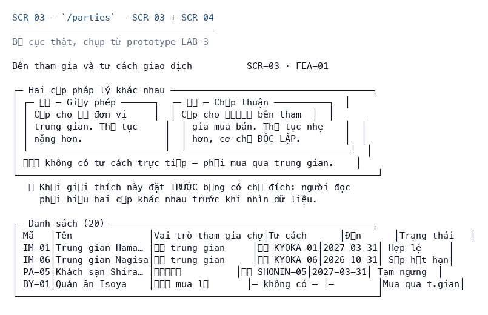

# SCR_03 — Danh sách và hồ sơ bên tham gia

> Biểu mẫu: **BM-2-901-51 v2.1** — Screen Specification · SUN ASTERISK VIETNAM CO., LTD · ISO/IEC 27001:2013 & ISO 9001:2015

---

## 1. History of change

| No | Version | Action | Nội dung thay đổi | Ngày | Người sửa | Approve |
|---|---|---|---|---|---|---|
| 1 | 0.1.0 | Add New | Khởi tạo từ bộ thiết kế LAB-4 | 2026-10-11 | nguyen-van-manh-c | |

---

## 2. Layout

**Design:** bản dựng chạy thật tại `/parties` của prototype LAB-3

> Ảnh chụp từ prototype đang chạy. Màn hình này **đã code**, nên bố cục dưới đây là bố cục thật,
> không phải phác thảo.

---

## 3. Description

Đây là màn hình thể hiện rõ nhất hai cấp pháp lý. Xem ADR-006.

**Nguồn đặc tả:** mã nguồn LAB-3.

**Vai trò truy cập:** Quản trị hệ thống `F` · Tiếp nhận lô `R` · Thẩm định `R` · Chốt giao dịch `R` · Giao hàng `R` · Đối soát `F`

---

## 4. View

### 4.1 Danh sách item

| ID | Item Name | Item Type | Required | Note |
|---|---|---|---|---|
| **A** | **Danh sách và hồ sơ bên tham gia** | | | |
| 1.0 | code | Label | - | Khoá duy nhất, ví dụ IM-01 |
| 2.0 | name | Label | - |  |
| 3.0 | kind | Label | - | 4 vai trò tham gia chợ |
| 4.0 | qualification.kind | Label | - | 許可 hoặc 承認 |
| 5.0 | qualification.cert_no | Label | - |  |
| 6.0 | qualification.valid_to | Label | - | Nền tảng cho nhãn trạng thái |
| 7.0 | qualification.suspended | Label | - |  |

### 4.2 Validation

| ID | Type | Min | Max | Default | Ghi chú |
|---|---|---|---|---|---|
| – | – | | | | Màn hình chỉ đọc, không có item nhận nhập liệu |

### 4.3 Data Mapping

| ID | Data Source | API ID | API URL | Key / Param | Ghi chú |
|---|---|---|---|---|---|
| A-1 | API | `PTY-1` | `GET /api/parties` | — | tra ở [`_common/api-list.md`](../../_common/api-list.md) |

---

## 5. Event

| ID | Given (Pre-condition) | When (Trigger/Action) | Then (Result) | Note |
|---|---|---|---|---|
| **Initializing Process** | | | | |
| - | đã đăng nhập, phiên hợp lệ | mở màn hình | 1. Gọi `GET /api/parties` 2. Hiển thị danh sách | |
| **Standard Process** | | | | |
| A-1 | - | thao tác trên item | 許可 chỉ gán được cho 仲卸, 承認 chỉ gán cho 売買参加者 — trigger qualification_kind_check | |
| A-2 | - | thao tác trên item | 買出人 không có dòng tư cách nào, hiển thị 'Mua qua trung gian' | |
| A-3 | - | thao tác trên item | valid_to < hôm nay → nhãn Hết hạn; còn ≤ 30 ngày → Sắp hết hạn | |
| **Error Handling** | | | | |
| - | chưa đăng nhập | gọi API | HTTP 401, chuyển về `/login?next=` | `M_40` |

---

## 6. Other Notes

- **Trạng thái:** Hợp lệ · Sắp hết hạn · Hết hạn · Tạm ngưng · Mua qua trung gian
- 許可 chỉ gán được cho 仲卸, 承認 chỉ gán cho 売買参加者 — trigger qualification_kind_check
- 買出人 không có dòng tư cách nào, hiển thị 'Mua qua trung gian'
- valid_to < hôm nay → nhãn Hết hạn; còn ≤ 30 ngày → Sắp hết hạn
