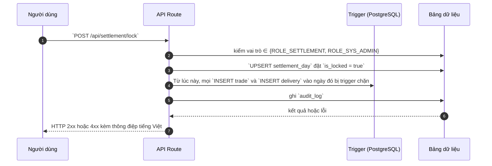

# STL_LOCK — Khoá ngày nghiệp vụ

> Biểu mẫu: **BM-2-901-53 v1.1** — Technical Design · SUN ASTERISK VIETNAM CO., LTD · ISO/IEC 27001:2013 & ISO 9001:2015

---

## 1. History of change

| No | Version | Action | Nội dung thay đổi | Ngày | Người sửa |
|---|---|---|---|---|---|
| 1 | 0.1.0 | Add New | Trích từ `src/app/api/settlement/lock/route.ts` của prototype LAB-3 | 2026-10-11 | nguyen-van-manh-c |

---

## 2. Sequence diagram

---

## 3. Description

Mã nguồn: `src/app/api/settlement/lock/route.ts`

Luồng xử lý chia làm các bước ở mục 4. Điểm chung của mọi hàm trong hệ thống này: **quy tắc nghiệp vụ
thi hành ở tầng database bằng trigger**, tầng API chỉ chuyển tiếp thông điệp lỗi cho người dùng đọc.
Xem [ADR-002](../../../_extra/decisions/ADR-002-quy-tac-o-tang-database.md).

---

## 4. Detail function

### 4.1. Kiểm quyền

| Mục | Nội dung |
|---|---|
| Input / điều kiện | Vai trò phải là đối soát hoặc quản trị |
| Error | 403 kèm lý do |

### 4.2. Ghi trạng thái khoá

| Mục | Nội dung |
|---|---|
| Input / điều kiện | UPSERT theo `business_day` |
| Error | 400 |

### 4.3. Hiệu lực tức thì

| Mục | Nội dung |
|---|---|
| Input / điều kiện | Trigger `trade_check` và `delivery_quantity_check` đọc `day_is_locked()` mỗi lần ghi |
| Error | — |

---

## 5. Other Notes

- Mọi thông điệp lỗi do trigger ném ra được trả **nguyên văn** cho người dùng, không thay bằng câu chung chung.
- Mã lỗi dùng chung tra ở [`_common/error-codes.md`](../../_common/error-codes.md).
