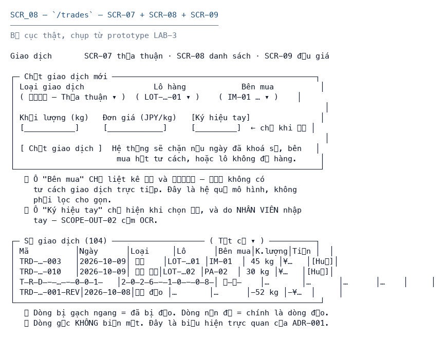

# SCR_08 — Danh sách và huỷ giao dịch

> Biểu mẫu: **BM-2-901-51 v2.1** — Screen Specification · SUN ASTERISK VIETNAM CO., LTD · ISO/IEC 27001:2013 & ISO 9001:2015

---

## 1. History of change

| No | Version | Action | Nội dung thay đổi | Ngày | Người sửa | Approve |
|---|---|---|---|---|---|---|
| 1 | 0.1.0 | Add New | Khởi tạo từ bộ thiết kế LAB-4 | 2026-10-11 | nguyen-van-manh-c | |

---

## 2. Layout

**Design:** bản dựng chạy thật tại `/trades` của prototype LAB-3

> Ảnh chụp từ prototype đang chạy. Màn hình này **đã code**, nên bố cục dưới đây là bố cục thật,
> không phải phác thảo.

---

## 3. Description

Huỷ trả lại khối lượng cho lô. Xem ADR-001.

**Nguồn đặc tả:** mã nguồn LAB-3.

**Vai trò truy cập:** Quản trị hệ thống `F` · Tiếp nhận lô `–` · Thẩm định `–` · Chốt giao dịch `F` · Giao hàng `R` · Đối soát `F`

---

## 4. View

### 4.1 Danh sách item

| ID | Item Name | Item Type | Required | Note |
|---|---|---|---|---|
| **A** | **Danh sách và huỷ giao dịch** | | | |
| 1.0 | trade_code | Label | - |  |
| 2.0 | kind | Text box | Không | Nhãn 相対 hoặc せり |
| 3.0 | reverses_id | Label | - | Khác null = dòng đảo |
| 4.0 | lý do huỷ | Text box | Có | Ghi vào audit_log |

### 4.2 Validation

| ID | Type | Min | Max | Default | Ghi chú |
|---|---|---|---|---|---|
| A-4 | String |  | | | bắt buộc; lỗi dùng `M_01` |

### 4.3 Data Mapping

| ID | Data Source | API ID | API URL | Key / Param | Ghi chú |
|---|---|---|---|---|---|
| A-1 | API | `TRD-1` | `GET /api/trades` | — | tra ở [`_common/api-list.md`](../../_common/api-list.md) |
| A-2 | API | `TRD-3` | `POST /api/trades/reverse` | — | tra ở [`_common/api-list.md`](../../_common/api-list.md) |

---

## 5. Event

| ID | Given (Pre-condition) | When (Trigger/Action) | Then (Result) | Note |
|---|---|---|---|---|
| **Initializing Process** | | | | |
| - | đã đăng nhập, phiên hợp lệ | mở màn hình | 1. Gọi `GET /api/trades` 2. Hiển thị danh sách | |
| **Standard Process** | | | | |
| A-1 | - | thao tác trên item | Không UPDATE, không DELETE — trigger chặn ở database | |
| A-2 | - | thao tác trên item | Dòng đã là dòng đảo thì không đảo tiếp — trả 409 | |
| A-3 | - | thao tác trên item | Một dòng gốc chỉ đảo một lần — kiểm ở tầng API (chưa có UNIQUE, xem R-06) | |
| **Error Handling** | | | | |
| - | chưa đăng nhập | gọi API | HTTP 401, chuyển về `/login?next=` | `M_40` |

---

## 6. Other Notes

- **Trạng thái:** Bình thường · Đã bị đảo (gạch ngang) · Là dòng đảo (nền đỏ)
- Không UPDATE, không DELETE — trigger chặn ở database
- Dòng đã là dòng đảo thì không đảo tiếp — trả 409
- Một dòng gốc chỉ đảo một lần — kiểm ở tầng API (chưa có UNIQUE, xem R-06)
