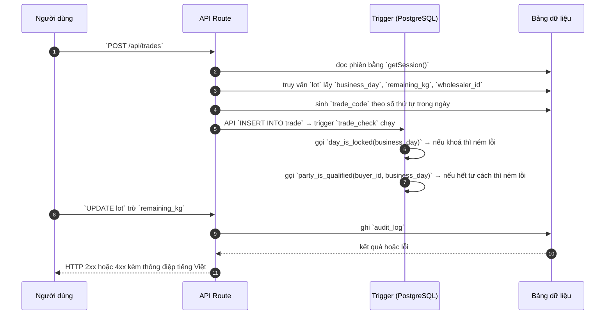

# TRD_CREATE — Chốt giao dịch

> Biểu mẫu: **BM-2-901-53 v1.1** — Technical Design · SUN ASTERISK VIETNAM CO., LTD · ISO/IEC 27001:2013 & ISO 9001:2015

---

## 1. History of change

| No | Version | Action | Nội dung thay đổi | Ngày | Người sửa |
|---|---|---|---|---|---|
| 1 | 0.1.0 | Add New | Trích từ `src/app/api/trades/route.ts` của prototype LAB-3 | 2026-10-11 | nguyen-van-manh-c |

---

## 2. Sequence diagram

---

## 3. Description

Mã nguồn: `src/app/api/trades/route.ts`

Luồng xử lý chia làm các bước ở mục 4. Điểm chung của mọi hàm trong hệ thống này: **quy tắc nghiệp vụ
thi hành ở tầng database bằng trigger**, tầng API chỉ chuyển tiếp thông điệp lỗi cho người dùng đọc.
Xem [ADR-002](../../../_extra/decisions/ADR-002-quy-tac-o-tang-database.md).

---

## 4. Detail function

### 4.1. Validate request

| Mục | Nội dung |
|---|---|
| Input / điều kiện | Body phải có `lot_id`, `buyer_id`, `quantity_kg > 0`, `unit_price > 0` |
| Error | 400 kèm thông điệp tiếng Việt |

### 4.2. Kiểm tồn lô

| Mục | Nội dung |
|---|---|
| Input / điều kiện | `quantity_kg <= lot.remaining_kg` |
| Error | 409 kèm số kg còn lại |

### 4.3. Ghi vào sổ

| Mục | Nội dung |
|---|---|
| Input / điều kiện | INSERT, trigger kiểm ngày khoá và tư cách |
| Error | 409 kèm nguyên văn thông điệp trigger |

### 4.4. Trừ tồn và ghi log

| Mục | Nội dung |
|---|---|
| Input / điều kiện | UPDATE lot, INSERT audit_log |
| Error | lỗi ghi log bị nuốt, không chặn nghiệp vụ |

---

## 5. Other Notes

- Mọi thông điệp lỗi do trigger ném ra được trả **nguyên văn** cho người dùng, không thay bằng câu chung chung.
- Mã lỗi dùng chung tra ở [`_common/error-codes.md`](../../_common/error-codes.md).
